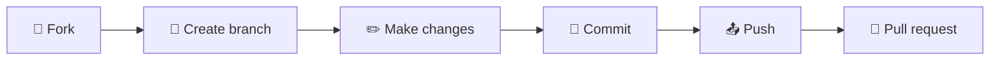

<div align="center">


<br/>

<a id="engine"></a>

<h2>⚙️ ENGINE</h2>


<br/><br/>

<p><b>Powered by <a href="https://www.npmjs.com/package/fca-nx">fca-nx</a></b><br/>
The Facebook Chat API layer that drives every message, reaction and event the bot handles.</p>


<br/><br/>


<br/><br/>


<br/><br/>

<a href="https://github.com/xalmandevv/GOAT-BOT-UPDATED"></a>
<a href="https://github.com/xalmandevv/GOAT-BOT-UPDATED/network/members"></a>
<a href="https://github.com/xalmandevv/GOAT-BOT-UPDATED"></a>
<a href="https://github.com/xalmandevv/GOAT-BOT-UPDATED"></a>

<br/>


<a href="https://github.com/xalmandevv/GOAT-BOT-UPDATED/blob/main/LICENSE"></a>

<br/><br/>

<a href="#about">About</a> •
<a href="#features">Features</a> •
<a href="#roles">Roles</a> •
<a href="#structure">Structure</a> •
<a href="#install">Install</a> •
<a href="#config">Config</a> •
<a href="#support">Support</a>

</div>

<br/>

---

<a id="about"></a>

<div align="center">

## 🐐 About

**Next-Generation Facebook Messenger Automation**

*Powerful • Modular • Fast • Customizable*

</div>

GOAT-BOT-UPDATED is a modular Facebook Messenger bot built for performance, flexibility and easy customization. It uses a command-based architecture with support for automation, AI, media processing, user management, group management and premium features.

<div align="center">

| 🧩 **240+** | 🎯 **7** | 🌐 **2** | 🗄️ **2** | 🖥️ **1** |
|:---:|:---:|:---:|:---:|:---:|
| Commands | Event handlers | Languages (EN / VI) | Databases (SQLite / MongoDB) | Web dashboard |

</div>

---

<a id="features"></a>

## 🚀 Features

<table>
<tr>
<td width="50%" valign="top">

### 🤖 Automation
- ⚡ Fast command execution
- 🧩 Modular command system
- 🔄 Event-based architecture
- 📡 Real-time Messenger events
- ⏱️ Command cooldown
- 🛠️ Custom event handlers

</td>
<td width="50%" valign="top">

### 👑 Premium
- 💎 Premium membership
- ⭐ VIP commands
- 🔐 Role-based permissions
- ⏳ Membership expiration
- 👤 User management
- 💬 Thread management

</td>
</tr>
<tr>
<td width="50%" valign="top">

### 🧠 AI
- 🎨 AI image generation
- 🎬 AI video generation
- ✨ AI-powered commands
- 🪄 Image transformation
- 📝 Prompt processing
- 🔌 External API integration

</td>
<td width="50%" valign="top">

### 📦 Media
- 🖼️ Image processing
- 🎵 Audio utilities
- 🎬 Video utilities
- 📥 Media downloading
- 📤 File uploading
- 🔗 URL processing

</td>
</tr>
<tr>
<td width="50%" valign="top">

### 🛡️ Security
- 🔒 Permission system
- 👑 Admin controls
- 🚫 Spam protection
- 📋 Whitelist mode
- ⚠️ Error handling
- ⚙️ Configurable restrictions

</td>
<td width="50%" valign="top">

### ⚡ Performance
- 🚀 Lightweight architecture
- 🔥 Optimized command loading
- 🔄 Auto restart and auto recovery
- 📨 Alerts via Gmail, Telegram or Discord
- 💾 Efficient data handling
- 🧩 Easy extensibility

</td>
</tr>
</table>

---

<a id="roles"></a>

## 🧠 Smart Role System

Five permission tiers, checked in strict priority order.

| Role | Level | Source |
|---|:---:|---|
| 👨‍💻 Developer | **4** | `devUsers` |
| 💎 Premium | **3** | `premiumUsers` |
| 👑 Bot Admin | **2** | `adminBot` |
| 🛡️ Group Admin | **1** | the thread's own admin list |
| 👤 Member | **0** | default |

---

## 🎨 Project Identity

<div align="center">

| | |
|:---|:---|
| 🐐 **Project** | GOAT-BOT-UPDATED |
| ⚙️ **Engine** | [fca-nx](https://www.npmjs.com/package/fca-nx) `^7.2.5` |
| 👨‍💻 **Developer** | NX / XALMAN |
| 🟢 **Node.js** | 22.x |
| 🏷️ **Version** | 2.0 |
| 📜 **License** | MIT |

</div>

---

<a id="structure"></a>

## 🧩 Project Structure

```text
GOAT-BOT-UPDATED/
├── 📄 index.js               # Entry point
├── 📄 Goat.js                # Core runtime
├── ⚙️  config.json            # Main settings
├── ⚙️  configCommands.json    # Per-command settings
├── 🔑 account.txt            # Account session (account2.txt for a second one)
├── 📁 bot/
│   ├── login/                # Login and MQTT listener (fca-nx)
│   └── handler/              # Message, reaction and event handlers
├── 📁 scripts/
│   ├── cmds/                 # Commands
│   └── events/               # Event scripts
├── 📁 database/              # SQLite and MongoDB controllers, models
├── 📁 dashboard/             # Web dashboard
├── 📁 languages/             # en / vi language files
├── 📁 logger/  📁 func/      # Logging and helpers
├── 📄 updater.js             # Updater
└── 🐳 Dockerfile
```

### Command anatomy

Every command is a single file inside `scripts/cmds/`.

```js
module.exports = {
  config: {
    name: "hello",
    aliases: ["hi"],
    version: "1.0.0",
    author: "Xalman",
    countDown: 5,          // cooldown in seconds
    role: 0,               // 0 everyone, 1 group admin, 2 bot admin
    description: "Say hello",
    category: "FUN & SOCIAL",
    guide: "{pn} <text>"
  },

  onStart: async function ({ message, args }) {
    return message.reply(`Hello ${args.join(" ") || "there"} 👋`);
  }
};
```

Commands can also export `onReply`, `onChat`, `onReaction` and `onEvent` handlers.

---

## 📋 Requirements

| | Requirement | Version |
|:---:|---|:---:|
| 🟢 | Node.js | 22.x |
| 📦 | npm | 7+ |
| 🔧 | Git | Latest |
| 💬 | Facebook account | Required |

---

<a id="install"></a>

## 📥 Installation

```bash
git clone https://github.com/xalmandevv/GOAT-BOT-UPDATED.git
cd GOAT-BOT-UPDATED
npm install
```

**1. Add your account.** Put your Facebook session in `account.txt`.

**2. Edit `config.json`.** At minimum set your `prefix`, the UIDs in `adminBot` / `devUsers`, and your `timeZone`.

**3. Start the bot.**

```bash
node index.js
```

> [!WARNING]
> `account.txt` and `config.json` hold your login session and secrets. Never commit them to a public repository.

<details>
<summary><b>🐳 Run with Docker</b></summary>

<br/>

```bash
docker build -t goat-bot-updated .
docker run -d --name goat-bot goat-bot-updated
```

</details>

---

<a id="config"></a>

## ⚙️ Configuration

| Setting | What it does |
|---|---|
| `prefix` / `usePrefix` | Command prefix and whether it is required |
| `language` | Bot language: `en` or `vi` |
| `adminBot` / `devUsers` / `premiumUsers` | UIDs for each role |
| `database.type` | Storage backend: SQLite or MongoDB |
| `dashBoard` | Web dashboard on/off and port (default `5000`) |
| `serverUptime` / `autoUptime` | Built-in uptime server and ping |
| `autoRestart` | Scheduled restart |
| `whiteListMode` | Restrict the bot to approved users or threads |
| `notiWhenListenMqttError` | Alerts through Gmail, Telegram or Discord |
| `optionsFca` | Options passed to the fca-nx engine |

---

## 📊 GitHub Statistics

<div align="center">


<br/><br/>


<br/><br/>


</div>

---

## 🌟 Project Goals

<div align="center">

⚡ **Maximum Performance** &nbsp;•&nbsp; 🧩 **Clean Architecture** &nbsp;•&nbsp; 🔥 **Powerful Automation**

💎 **Premium Experience** &nbsp;•&nbsp; 🛡️ **Reliable Security** &nbsp;•&nbsp; 🚀 **Continuous Development**

</div>

---

## 🤝 Contributing

Contributions, suggestions and improvements are welcome.



---

<a id="support"></a>

## ⭐ Support

<div align="center">

If you like GOAT-BOT-UPDATED, consider supporting the project.

⭐ Star the repository &nbsp;•&nbsp; 🍴 Fork it &nbsp;•&nbsp; 🐛 Report bugs &nbsp;•&nbsp; 💡 Suggest features &nbsp;•&nbsp; 🤝 Contribute

</div>

---

## 🧑‍💻 Credits

Based on [Goat-Bot-V2](https://github.com/ntkhang03/Goat-Bot-V2) by **NTKhang**. Maintained and extended by **NX / XALMAN**.

> [!NOTE]
> This bot runs on a personal Facebook account. Automated accounts can be restricted by Facebook, so use it responsibly.

<br/>

<div align="center">

### 💜 NX

*"NEGATIVE XALMAN"*

**Developer • Builder • Creator**


<br/>

<a href="https://github.com/xalmandevv/GOAT-BOT-UPDATED"></a>

<br/><br/>


</div>
